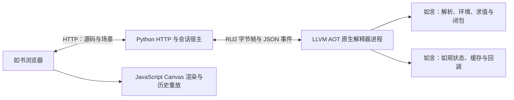

# 如书原生解释内核（bs 实验）

如书 0.9.0 可以选择用如言编写、由 LLVM AOT 编译成机器码的持久 AST 解释器。用户代码格在这个原生进程中解析和解释执行；解释器不调用 Python 前端、Python `Interpreter` 或 LLVM JIT 来执行代码格。

本阶段交付解释内核与如观桥接。HTTP 服务端、进程管理适配和构建驱动仍为 Python，浏览器仍使用原有 JavaScript。完整服务端自托管和代码格机器码编译不属于已经完成的能力。

## 构建与使用

需要已经可用的 LLVM 14 和本机 stage3。如尚未构建自举编译器，先运行 `python3 tools/bootstrap.py bootstrap`；Windows 可显式运行 `python3 tools/prepare_workspace.py --with-llvm`，下载工具到忽略的 `.build_tools`。

从仓库根目录构建：

```sh
python3 tools/build_rushu_kernel.py
```

Linux／WSL：

```sh
python3 -m rushu --native-kernel bin/rushu/native-kernel
```

Windows cmd.exe／PowerShell／Git Bash：

```sh
python3 -m rushu --native-kernel bin/rushu/native-kernel.exe
```

打开终端打印的完整地址，沿用原有运行、输入、停止和保存流程。省略 `--native-kernel` 继续使用原来的 Python 内核；JS 加速格仍保持独立 Worker 的语义。

解释器也可独立运行文件，例如 `bin/rushu/native-kernel examples/factorial.ru`（Windows 加 `.exe`），输出 `720`。完整用法为 `native-kernel SOURCE [STDLIB [ARGS...]]`；从其他工作目录运行且需要标准库时，应提供标准库目录。文件执行会调用合法的 `元初` 并保留退出码，代码格不会隐式调用 `元初`。

构建后运行核心程序不需要 Python、LLVM 或原始解释器源码；导入标准库／普通文件时仍需要相应 `.ru` 文件。用 Python 启动如书服务端则仍需要 Python。

## 当前语言范围

- 有限 binary64、事实、空、Unicode 句、阵、对、典；数值溢出、除零、索引／切片错误作为本格错误返回。
- 条件、循环、显式块、算／作、匿名函数、共享词法闭包、参数绑定及类型检查、显式卒／救；普通运行错误不由用户的救捕获。
- 同一会话共享变量和可变对象。顶层函数重定义保留已保存的旧函数值；旧实例仍引用自己的形。停止／重启直接终止并替换原生进程，清空状态。
- 用户形、字段、方法、继承与基本覆写检查；阵的排序、另成、逐位与典的逐目。典键当前只接受数、事实或句，形典键尚未接入。
- 字符串路径的普通文件外言与如:竞、如:文本、如:数学、如:随机、如:观。先解析静态依赖图，再在实际导入时初始化；本会话缓存已初始化模块与初始化失败。
- 受检查的件／录／件作成果，以及输入、标准输出、标准错误。文件权限仍是启动用户的正常权限。

词法／语法复用 `bootstrap/compiler.ru` 的已声明范围，名称字符表固定为 Unicode 13.0.0；不是完整 Python 前端的替换。已支持上游 `另若` 条件链，整链一个 `然.`，旧 `另 若` 仍按嵌套收尾；条件链与等价嵌套共享 128 层源码结构预算。具名模块声明、包与锁解析、如:密／如见当前明确拒绝或未接入。没有通用外部函数接口，也没有 ORC 或自动热点编译。

语法树与宿主调用都有深度预算；最大可递归层数不保证与 Python 内核相同。普通客体错误通过如言的结构化错误状态和正常调用帧清理返回；宿主最后的深度保护也使用显式卒传播，不使用 `longjmp`。Windows 的解释器产物单独预留 16 MiB 栈以容纳解释器宿主帧；不改变普通 AOT 程序或自举固定点的链接默认值。

## 实现边界

`rushu/native/interpreter.ru` 实现解析调度、客体环境、求值、调用和控制流；`kernel.ru` 实现入口和工作进程循环。新增 C 宿主只提供受检查数值原语、时间／路径、字节限额和传输，不包含 AST 求值器。原有 C 运行时负责值、资源和 GC。仅在构建解释器时加入宿主，普通产物不携带这部分代码。

`rushu/native_kernel.py` 负责启动原生进程、传递请求、恢复诊断来源和结束进程。`Session` 继续负责执行序号、generation、输入 request_id、迟到事件拒绝和历史容量。

`rushu/native/graphics.ru` 用如言维护绘图状态、几何／裁剪栈、缓存配方与句柄、回调及生命周期，调用同一个客体函数求值器。Python 适配层不调用 `GraphicsHost` 执行原生格，浏览器继续渲染可保存的声明式场景。



解释器构建单独启用固定字面量驻留和临时帧优化：数值常量在解析时转换一次，固定宿主字符串使用有根的 GC 表；帧仍有连续、预置为空的值槽，只在语句结束时清理实际写入的槽，标量写入也计入。调用者返回槽与 C 桥的临时返回值沿用原来的引用所有权。这些变化不启用于普通 AOT／自举编译器产物；退出时释放驻留表，并用独立帧检查、频繁 GC 和 sanitizer 检查清理行为。

输出按 UTF-8 计量、分块与合批，保留原有每次 2 MiB／16,384 事件门限及会话历史限制。输入请求、错误和完成前刷新输出。书本格式仍为版本 1，只保存源码与历史输出，重开不恢复活对象，也不自动执行。

## 原生如观

可在原生格中使用现有如观示例：基本图元、弧／扇形／贝塞尔／折线、颜色与透明度、文字对齐、变换与裁剪、缓存图像，以及帧／鼠标／键盘回调。回调保留客体闭包和共享可变状态；事件时间来自内核单调时钟，不能由前端注入。

新格执行会关闭上一画布，停止／重启会话会终止原生进程；旧画布和录制目标随即失效，旧图像的只读尺寸仍可读取。缓存只在初始化执行一次，不可嵌套或在事件回调中创建；缓存命令复制点阵及几何状态，保存的场景包含所引用的完整配方。重开只作静态重放，不恢复回调。

沿用每帧 2,048 命令／256 KiB、8 张缓存／4,194,304 像素／128 KiB 配方、64 层保存与 32 层裁剪限制。回调禁止交互输入；普通错误、未配对状态或超出预算会关闭交互，保留会话中已经产生的普通变量变化。

原生回调每 128 个求值／块入口步骤检查预算，并在返回时检查：500,000 AST 步、1 秒墙钟、相对创建画布时新增 64 MiB 动态值堆。AST 步不等于 Python 当前候选 logical-work-v2 的加权工作单位；这里的原生 AST 计数与阈值未随 Python 计量适配改变。堆字节包含值对象、阵／典／对象的容量及环境绑定，排除 C 栈、分配器元数据、OS 资源和传输临时缓冲；不是整个进程 RSS 上限。现有 10 秒硬看门狗负责终止阻塞的工作进程并重建会话，此时上下文清空。

画布只在如书协议会话中创建；独立文件执行仍可使用颜色等普通工具。普通 `ru build --target llvm` 仍显式拒绝如观，不能把解释内核的专用图形桥当作所有 AOT 产物都有的图形运行时。

## 私有进程协议 RU2

标准输入是 ASCII 头和按 UTF-8 字节数定长的载荷，不把用户源码或输入拼成控制语法：

```text
RU2 E SOURCE_BYTES NAME_BYTES\n
<source bytes><source-name bytes>
RU2 I INPUT_BYTES EOF_FLAG\n
<input bytes>
RU2 G EVENT_BYTES CANVAS_ID_BYTES\n
<event bytes><canvas-id bytes>
RU2 R 0 CANVAS_ID_BYTES\n
<canvas-id bytes>
RU2 Q 0 0\n
```

源码最多 800,000 字节，来源名称最多 16,384 字节。EOF_FLAG 为 0 或 1。非法头／超界帧终止连接，非法文本作为执行错误返回；正常前端仍沿用原有字符数与 UTF-8 验证。发送方必须处理短写入。

G 的载荷为四条定长边界内的行：事件名、横坐标、纵坐标、鼠标键，各以 LF 收尾；剩余字节原样作为按键文本，因此按键可含换行。事件只允许 frame、mouse_down/up/move、key_down/up、close；内核再次校验坐标、键与长度。R 表示宿主拒绝该画布的帧，关闭对应交互。时钟字段不进入协议。

标准输出为逐行 UTF-8 JSON。首行是 `{"type":"ready","protocol":2,"engine":"ru-ast"}`，后续为 output、input_request、error、done、graphics、graphics_closed、graphics_done。RU2 与旧 RU1 握手不兼容，适配器拒绝错误版本。来源名称是不可执行的诊断标识；来自旧闭包的错误保留定义格的身份。标准错误仅供进程异常退出诊断，不混入控制流。

## 验证入口

```sh
python3 -m unittest discover -s tests -p test_rushu_native.py -v
```

测试实际构建原生解释器，复用如书会话合同与标准库 golden，并检查禁止 Python 回退、裸产物、频繁 GC、错误后继续、重定义、来源、输入与停止。缺少 LLVM 时显式跳过；跳过不能代表已经验证该平台。

真实浏览器测试需自行备好 Playwright 和浏览器，显式运行：

```sh
python3 tools/qa_native_kernel.py --kernel bin/rushu/native-kernel --browser /path/to/chromium
```

该入口启动独立本机服务，禁用 Python 解析／解释回退，验证共享状态、闭包、诊断、输入、停止以及保存重开，最后关闭服务和所有原生子进程。测试不调用外部模型服务。

性能应分别测量首次响应、稳定解释吞吐、内存与长会话表现。解释器自身通过 AOT 编译不等于代码格达到 AOT 的速度，也不代表已经性能对齐 Dart。

RU2 的 [M5 验收与性能数据](rushu-m5-validation.md)已覆盖 Windows／WSL 及真实浏览器，记录的是 rebase 前冻结版本：一万次简单循环在 WSL／Windows 分别约 450／470 毫秒，同机 Python 内核约 16／12 毫秒；短格约 1–2 毫秒，密集计算仍需后续优化。整合 `wip` 后的功能复验见[整合记录](bs-wip-rebase-2026-10-22.md)，不把旧性能样本当作新产物测量。[首阶段 RU1 数据](rushu-native-2026-10-22/README.md)保留为历史快照。
